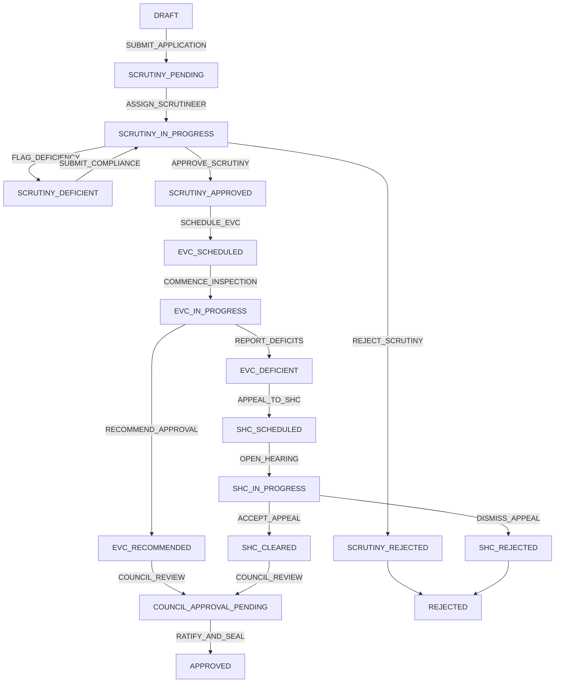

# ApprovalSync: Technical Implementation Plan
### Engineering Blueprint for AICTE Workflow Automation (SIH Edition)

[](#phased-milestone-roadmap)
[](#1-architectural-foundations--system-topology)
[](#3-module-b-cryptographic-audit-trail-merkle-trees)
[](#4-module-c-sla-timer--hierarchical-escalation-engine)

---

## Document Control

- **Project Name:** ApprovalSync (AICTE Workflow Automation Platform)
- **Target Initiative:** Smart India Hackathon (SIH)
- **Primary Stakeholder:** All India Council for Technical Education (AICTE), Ministry of Education, Govt. of India
- **Document Version:** 1.0.0-PROD
- **Target Runtimes:** Node.js 20 LTS, NestJS 10.x, TypeScript 5.3, PostgreSQL 16 Enterprise, Redis 7 Alpine

---

## Table of Contents

- [1. Architectural Foundations & System Topology](#1-architectural-foundations--system-topology)
  - [System Component Decomposition](#system-component-decomposition)
  - [JSONB Schema Evolution for Approval Process Handbook (APH)](#jsonb-schema-evolution-for-approval-process-handbook-aph)
- [2. Module A: State Machine Orchestrator](#2-module-a-state-machine-orchestrator)
  - [Deterministic Transition Graph](#deterministic-transition-graph)
  - [Role-Based Access Control (RBAC) Mapping](#role-based-access-control-rbac-mapping)
  - [Guard Interceptors & Atomic State Transitions](#guard-interceptors--atomic-state-transitions)
- [3. Module B: Cryptographic Audit Trail (Merkle Trees)](#3-module-b-cryptographic-audit-trail-merkle-trees)
  - [RFC 6962 Compliance & Canonical Hashing Specification](#rfc-6962-compliance--canonical-hashing-specification)
  - [Chained Hash Mathematics](#chained-hash-mathematics)
  - [Tamper-Evidence Scanner & Proof Generation Algorithm](#tamper-evidence-scanner--proof-generation-algorithm)
- [4. Module C: SLA Timer & Hierarchical Escalation Engine](#4-module-c-sla-timer--hierarchical-escalation-engine)
  - [Durable Execution Architecture with BullMQ & Redis](#durable-execution-architecture-with-bullmq--redis)
  - [Three-Tier Hierarchical Escalation Matrix](#three-tier-hierarchical-escalation-matrix)
  - [Real-Time Server-Sent Events (SSE) Dispatcher](#real-time-server-sent-events-sse-dispatcher)
- [5. Module D: Undertaking & Lease Validity Tracker](#5-module-d-undertaking--lease-validity-tracker)
  - [Statutory Lease Tenure Rules (AICTE APH Chapter 1)](#statutory-lease-tenure-rules-aicte-aph-chapter-1)
  - [Midnight Cron Daemon & Arithmetic Formulation](#midnight-cron-daemon--arithmetic-formulation)
  - [Automated Deficiency Report (PDF Engine) Generation](#automated-deficiency-report-pdf-engine-generation)
- [6. Module E: DigiLocker OAuth 2.0 & XMLDSig Integration](#6-module-e-digilocker-oauth-20--xmldsig-integration)
  - [DigiLocker Requester Authorization Flow](#digilocker-requester-authorization-flow)
  - [XMLDSig Signature Verification Architecture](#xmldsig-signature-verification-architecture)
  - [Sub-Document Auto-Ingestion Pipeline](#sub-document-auto-ingestion-pipeline)
- [7. Complete Database Schema Blueprint](#7-complete-database-schema-blueprint)
- [8. Container Orchestration & Deployment](#8-container-orchestration--deployment)
- [9. Testing Harness & Validation Suite](#9-testing-harness--validation-suite)
- [10. Phased Milestone Roadmap](#10-phased-milestone-roadmap)

---

## 1. Architectural Foundations & System Topology

### System Component Decomposition

ApprovalSync is structured into modular microservices communicating over synchronous REST/HTTPS for client interactions and asynchronous Redis messaging queues for background processing.

```
+----------------------------------------------------------------------------------------------------+
|                                    ApprovalSync Core Ecosystem                                     |
+----------------------------------------------------------------------------------------------------+
                                           |
                   +-----------------------+-----------------------+
                   |                                               |
                   v                                               v
     +---------------------------+                   +---------------------------+
     |   API & Workflow Core     |                   |    Background Scheduler   |
     |        (NestJS API)       |                   |      (BullMQ Worker)      |
     +-------------+-------------+                   +-------------+-------------+
                   |                                               |
                   | REST & Guard Pipeline                         | Durable Job Processing
                   v                                               v
     +---------------------------+                   +---------------------------+
     |   State Machine Engine    |                   |   Hierarchical SLA Engine |
     | - Transition Validators   |                   | - 80% Tier 1 RO Warn      |
     | - RBAC Guard Resolvers    |                   | - 100% Tier 2 Dir Breach  |
     | - Concurrency Locks       |                   | - 120% Tier 3 Council Lock|
     +-------------+-------------+                   +-------------+-------------+
                   |                                               |
                   | SHA-256 Block Chaining                        | Midnight Cron
                   v                                               v
     +---------------------------+                   +---------------------------+
     |  Cryptographic Audit Core |                   | Compliance & Lease Daemon |
     | - RFC 8785 Canonicalizer  |                   | - 30-Year Lease Verifier  |
     | - RFC 6962 Merkle Hash    |                   | - 25-Year Live Checker    |
     | - Tamper Detection Engine |                   | - Deficiency PDF Engine   |
     +-------------+-------------+                   +-------------+-------------+
                   |                                               |
                   +-----------------------+-----------------------+
                                           |
                                           v
                   +-----------------------------------------------+
                   |       PostgreSQL 16 Enterprise Cluster        |
                   |   - JSONB Dynamic Approval Forms + GIN        |
                   |   - Immutable Append-Only WORM Audit Table    |
                   |   - Relational Envelopes & SLA State Tables   |
                   +-----------------------------------------------+
```

### JSONB Schema Evolution for Approval Process Handbook (APH)

The AICTE Approval Process Handbook (APH) is updated annually. Changes frequently alter requirements for:
* Minimum land acreage based on terrain (Metro vs Rural).
* Built-up area requirements per student intake.
* Required specialized laboratory instruments.
* Faculty-student ratio norms (1:15, 1:20, or specialized PhD guides).

ApprovalSync standardizes a **Hybrid Document-Relational Pattern**:
1. Fixed relational columns (`id`, `application_number`, `current_state`, `academic_year`, `institution_id`) handle routing, index partitioning, and joins.
2. The `payload_data JSONB` column stores the nested, evolving APH form data:

```json
{
  "institution_profile": {
    "trust_society_name": "Vidya Vikas Educational Trust",
    "registration_number": "MAH/789/2004",
    "institution_category": "Private-Unaided",
    "minority_status": false
  },
  "land_details": {
    "ownership_type": "REGISTERED_LEASE",
    "total_acres": 12.5,
    "deed_number": "LD-9942/2012",
    "sub_registrar_office": "Pune Urban-4",
    "lease_start_date": "2012-04-01",
    "lease_expiry_date": "2042-03-31",
    "land_use_certificate_issued": true
  },
  "infrastructure_metrics": {
    "total_built_up_area_sqm": 18450.0,
    "instructional_area_sqm": 9200.0,
    "administrative_area_sqm": 2100.0,
    "number_of_laboratories": 36,
    "computer_center_capacity": 450
  },
  "courses_proposed": [
    {
      "program": "ENGINEERING_AND_TECHNOLOGY",
      "level": "UNDER_GRADUATE",
      "course_name": "Artificial Intelligence and Machine Learning",
      "intake_approved_prior": 60,
      "intake_applied_for": 120,
      "nba_accreditation_status": "ACCREDITED"
    }
  ]
}
```

---

## 2. Module A: State Machine Orchestrator

### Deterministic Transition Graph

The State Machine enforces a mathematically closed directed graph. Direct transitions outside the defined edge paths are rejected at the API controller boundary before any database interaction takes place.



### Role-Based Access Control (RBAC) Mapping

Every event triggered within the State Machine demands specific cryptographic token authorizations. Roles are hierarchical and domain-partitioned.

```typescript
export enum AicteRole {
  INSTITUTE_ADMIN = 'ROLE_INSTITUTE_ADMIN',
  SCRUTINY_OFFICER = 'ROLE_SCRUTINY_OFFICER',
  REGIONAL_OFFICER = 'ROLE_REGIONAL_OFFICER',
  EVC_INSPECTOR = 'ROLE_EVC_INSPECTOR',
  EVC_CHAIRMAN = 'ROLE_EVC_CHAIRMAN',
  SHC_MEMBER = 'ROLE_SHC_MEMBER',
  SHC_CHAIRMAN = 'ROLE_SHC_CHAIRMAN',
  AICTE_DIRECTOR = 'ROLE_AICTE_DIRECTOR',
  MEMBER_SECRETARY = 'ROLE_MEMBER_SECRETARY',
  VIGILANCE_OFFICER = 'ROLE_VIGILANCE_OFFICER',
}
```

#### State Transition Authorization Matrix

```typescript
export interface StateTransitionRule {
  from: WorkflowStateEnum;
  event: WorkflowEventEnum;
  to: WorkflowStateEnum;
  allowedRoles: AicteRole[];
  guardCondition?: (context: TransitionContext) => Promise<boolean>;
}

export const STATE_TRANSITION_RULES: StateTransitionRule[] = [
  {
    from: WorkflowStateEnum.DRAFT,
    event: WorkflowEventEnum.SUBMIT_APPLICATION,
    to: WorkflowStateEnum.SCRUTINY_PENDING,
    allowedRoles: [AicteRole.INSTITUTE_ADMIN],
    guardCondition: async (ctx) => {
      // Must have verified land undertaking before initial submission
      return ctx.application.payloadData?.land_details?.total_acres > 0;
    },
  },
  {
    from: WorkflowStateEnum.SCRUTINY_PENDING,
    event: WorkflowEventEnum.ASSIGN_SCRUTINEER,
    to: WorkflowStateEnum.SCRUTINY_IN_PROGRESS,
    allowedRoles: [AicteRole.REGIONAL_OFFICER],
  },
  {
    from: WorkflowStateEnum.SCRUTINY_IN_PROGRESS,
    event: WorkflowEventEnum.APPROVE_SCRUTINY,
    to: WorkflowStateEnum.SCRUTINY_APPROVED,
    allowedRoles: [AicteRole.SCRUTINY_OFFICER],
    guardCondition: async (ctx) => {
      // Must not have pending unresolved document deficiencies
      return ctx.deficienciesCount === 0;
    },
  },
  {
    from: WorkflowStateEnum.SCRUTINY_APPROVED,
    event: WorkflowEventEnum.SCHEDULE_EVC,
    to: WorkflowStateEnum.EVC_SCHEDULED,
    allowedRoles: [AicteRole.REGIONAL_OFFICER],
  },
  {
    from: WorkflowStateEnum.EVC_SCHEDULED,
    event: WorkflowEventEnum.COMMENCE_INSPECTION,
    to: WorkflowStateEnum.EVC_IN_PROGRESS,
    allowedRoles: [AicteRole.EVC_INSPECTOR, AicteRole.EVC_CHAIRMAN],
  },
  {
    from: WorkflowStateEnum.EVC_IN_PROGRESS,
    event: WorkflowEventEnum.RECOMMEND_APPROVAL,
    to: WorkflowStateEnum.EVC_RECOMMENDED,
    allowedRoles: [AicteRole.EVC_CHAIRMAN],
  },
  {
    from: WorkflowStateEnum.EVC_IN_PROGRESS,
    event: WorkflowEventEnum.REPORT_DEFICITS,
    to: WorkflowStateEnum.EVC_DEFICIENT,
    allowedRoles: [AicteRole.EVC_CHAIRMAN],
  },
  {
    from: WorkflowStateEnum.EVC_DEFICIENT,
    event: WorkflowEventEnum.APPEAL_TO_SHC,
    to: WorkflowStateEnum.SHC_SCHEDULED,
    allowedRoles: [AicteRole.INSTITUTE_ADMIN, AicteRole.AICTE_DIRECTOR],
  },
  {
    from: WorkflowStateEnum.SHC_SCHEDULED,
    event: WorkflowEventEnum.OPEN_HEARING,
    to: WorkflowStateEnum.SHC_IN_PROGRESS,
    allowedRoles: [AicteRole.SHC_CHAIRMAN],
  },
  {
    from: WorkflowStateEnum.SHC_IN_PROGRESS,
    event: WorkflowEventEnum.ACCEPT_APPEAL,
    to: WorkflowStateEnum.SHC_CLEARED,
    allowedRoles: [AicteRole.SHC_CHAIRMAN],
  },
  {
    from: WorkflowStateEnum.EVC_RECOMMENDED,
    event: WorkflowEventEnum.COUNCIL_REVIEW,
    to: WorkflowStateEnum.COUNCIL_APPROVAL_PENDING,
    allowedRoles: [AicteRole.AICTE_DIRECTOR],
  },
  {
    from: WorkflowStateEnum.COUNCIL_APPROVAL_PENDING,
    event: WorkflowEventEnum.RATIFY_AND_SEAL,
    to: WorkflowStateEnum.APPROVED,
    allowedRoles: [AicteRole.MEMBER_SECRETARY],
  },
];
```

### Guard Interceptors & Atomic State Transitions

To guarantee that no rogue thread can bypass the State Machine:
1. All transition requests are mediated by `StateMachineGuard`.
2. Execution occurs within an isolated PostgreSQL transaction using `SELECT ... FOR UPDATE` row locks.
3. If an unauthorized state change is requested, the system raises an `IllegalStateTransitionException`.

```typescript
@Injectable()
export class StateMachineService {
  constructor(
    private readonly dataSource: DataSource,
    private readonly auditLedgerService: AuditLedgerService,
    private readonly slaService: SlaService,
  ) {}

  async executeTransition(
    applicationId: string,
    event: WorkflowEventEnum,
    actor: AuthenticatedUser,
    transitionRemarks: string,
  ): Promise<ApplicationEntity> {
    const queryRunner = this.dataSource.createQueryRunner();
    await queryRunner.connect();
    await queryRunner.startTransaction('SERIALIZABLE');

    try {
      // 1. Acquire pessimistic lock on application record
      const app = await queryRunner.manager.findOne(ApplicationEntity, {
        where: { id: applicationId },
        lock: { mode: 'pessimistic_write' },
      });

      if (!app) {
        throw new NotFoundException(`Application with ID ${applicationId} not found`);
      }

      // 2. Locate rule matching current state and event
      const rule = STATE_TRANSITION_RULES.find(
        (r) => r.from === app.currentState && r.event === event,
      );

      if (!rule) {
        throw new ConflictException(
          `Illegal transition: No edge defined from state '${app.currentState}' with event '${event}'.`,
        );
      }

      // 3. Enforce RBAC
      if (!rule.allowedRoles.includes(actor.role as AicteRole)) {
        throw new ForbiddenException(
          `Unauthorized: Role '${actor.role}' lacks permission for transition event '${event}'.`,
        );
      }

      // 4. Evaluate Guard Condition (if any)
      if (rule.guardCondition) {
        const canPass = await rule.guardCondition({ application: app, actor });
        if (!canPass) {
          throw new BadRequestException(`Guard condition rejected transition to '${rule.to}'.`);
        }
      }

      const previousState = app.currentState;
      app.currentState = rule.to;
      app.updatedAt = new Date();

      // 5. Persist Application State
      const updatedApp = await queryRunner.manager.save(app);

      // 6. Write Cryptographic Audit Block (Module B)
      await this.auditLedgerService.appendBlockTransactional(queryRunner.manager, {
        applicationId: app.id,
        actorId: actor.id,
        actorRole: actor.role,
        eventType: event,
        previousState,
        newState: rule.to,
        remarks: transitionRemarks,
      });

      // 7. Re-initialize SLA Timer for the new stage (Module C)
      await this.slaService.onStateTransitionTransactional(queryRunner.manager, app.id, rule.to);

      await queryRunner.commitTransaction();
      return updatedApp;
    } catch (err) {
      await queryRunner.rollbackTransaction();
      throw err;
    } finally {
      await queryRunner.release();
    }
  }
}
```

---

## 3. Module B: Cryptographic Audit Trail (Merkle Trees)

### RFC 6962 Compliance & Canonical Hashing Specification

To achieve verifiable tamper-evidence, ApprovalSync implements a cryptographically bound append-only ledger modeled on **RFC 6962 (Certificate Transparency)**. 

Every event creates an immutable audit log entry where the payload is hashed, chained to the antecedent block hash, and stored with an explicit sequence number.

#### Canonical JSON Serialization (RFC 8785)
JSON key serialization variances across platforms can alter SHA-256 digests. ApprovalSync enforces strict RFC 8785 JSON Canonicalization Scheme (JCS) before any hash calculation:
1. Object keys are sorted lexicographically by UTF-16 code point order.
2. No extraneous whitespace, newlines, or indentations are included.
3. Numerical precision is formatted to standard IEEE 754 representations.

```typescript
import * as crypto from 'crypto';

export function canonicalizeJson(obj: any): string {
  if (obj === null || typeof obj !== 'object') {
    return JSON.stringify(obj);
  }
  if (Array.isArray(obj)) {
    return '[' + obj.map((item) => canonicalizeJson(item)).join(',') + ']';
  }
  const keys = Object.keys(obj).sort();
  const sortedPairs = keys.map(
    (key) => `${JSON.stringify(key)}:${canonicalizeJson(obj[key])}`,
  );
  return '{' + sortedPairs.join(',') + '}';
}
```

### Chained Hash Mathematics

For any application $A$, let the genesis state hash be defined as:
$$H_0 = \text{"0000000000000000000000000000000000000000000000000000000000000000"}$$

For each subsequent audit log $N \ge 1$:
1. **Leaf Hash Formulation (RFC 6962 Leaf Prefix 0x00):**
   $$\text{LeafData}_N = \text{JCS}(\text{PayloadCanonical}_N)$$
   $$\text{LeafHash}_N = \text{SHA-256}(0x00 \mathbin{\Vert} \text{LeafData}_N)$$
2. **Current Chain Hash Formulation (RFC 6962 Node Prefix 0x01):**
   $$\text{CurrentHash}_N = \text{SHA-256}(0x01 \mathbin{\Vert} \text{CurrentHash}_{N-1} \mathbin{\Vert} \text{LeafHash}_N \mathbin{\Vert} \text{Timestamp}_N)$$

```typescript
export class MerkleChainHasher {
  static computeLeafHash(canonicalPayload: string): string {
    const leafPrefix = Buffer.from([0x00]);
    const payloadBuffer = Buffer.from(canonicalPayload, 'utf8');
    return crypto
      .createHash('sha256')
      .update(Buffer.concat([leafPrefix, payloadBuffer]))
      .digest('hex');
  }

  static computeCurrentHash(
    previousHash: string,
    leafHash: string,
    isoTimestamp: string,
  ): string {
    const nodePrefix = Buffer.from([0x01]);
    const prevBuffer = Buffer.from(previousHash, 'hex');
    const leafBuffer = Buffer.from(leafHash, 'hex');
    const timeBuffer = Buffer.from(isoTimestamp, 'utf8');

    return crypto
      .createHash('sha256')
      .update(Buffer.concat([nodePrefix, prevBuffer, leafBuffer, timeBuffer]))
      .digest('hex');
  }
}
```

### Tamper-Evidence Scanner & Proof Generation Algorithm

A dedicated background worker periodically scans all applications, recalculating the hash chains from Block 1 through Block $N$. If an adversary executes an unauthorized direct database mutation:
* An application's current state differs from the signed canonical payload.
* Or the chained hash equation $\text{CurrentHash}_N \neq \text{SHA-256}(\dots)$ fails.

```typescript
@Injectable()
export class TamperScannerService {
  constructor(
    @InjectRepository(AuditLogEntity)
    private readonly auditRepo: Repository<AuditLogEntity>,
    @InjectRepository(ApplicationEntity)
    private readonly appRepo: Repository<ApplicationEntity>,
  ) {}

  async verifyApplicationLedger(applicationId: string): Promise<LedgerVerificationResult> {
    const logs = await this.auditRepo.find({
      where: { applicationId },
      order: { sequenceNumber: 'ASC' },
    });

    if (logs.length === 0) {
      return { isValid: true, totalBlocks: 0 };
    }

    let expectedPrevHash = '0'.repeat(64);

    for (const log of logs) {
      // 1. Verify previous hash chaining
      if (log.previousHash !== expectedPrevHash) {
        return {
          isValid: false,
          corruptedSequence: log.sequenceNumber,
          error: `Chain broken at sequence ${log.sequenceNumber}. Stored previousHash ${log.previousHash} does not match expected ${expectedPrevHash}.`,
        };
      }

      // 2. Recompute Leaf Hash using JCS
      const canonicalPayload = canonicalizeJson(log.payloadCanonical);
      const computedLeafHash = MerkleChainHasher.computeLeafHash(canonicalPayload);
      if (computedLeafHash !== log.leafHash) {
        return {
          isValid: false,
          corruptedSequence: log.sequenceNumber,
          error: `Leaf hash mismatch at sequence ${log.sequenceNumber}. Payload was tampered with!`,
        };
      }

      // 3. Recompute Current Block Hash
      const computedCurrentHash = MerkleChainHasher.computeCurrentHash(
        log.previousHash,
        log.leafHash,
        log.createdAt.toISOString(),
      );
      if (computedCurrentHash !== log.currentHash) {
        return {
          isValid: false,
          corruptedSequence: log.sequenceNumber,
          error: `Current hash mismatch at sequence ${log.sequenceNumber}. Block signature invalid!`,
        };
      }

      expectedPrevHash = log.currentHash;
    }

    // 4. Cross-verify the current application table state against the latest log
    const latestLog = logs[logs.length - 1];
    const app = await this.appRepo.findOne({ where: { id: applicationId } });
    if (app && app.currentState !== latestLog.payloadCanonical.newState) {
      return {
        isValid: false,
        corruptedSequence: latestLog.sequenceNumber,
        error: `Database row tampering detected: Application table current_state '${app.currentState}' does not match cryptographic ledger state '${latestLog.payloadCanonical.newState}'.`,
      };
    }

    return { isValid: true, totalBlocks: logs.length };
  }
}
```

---

## 4. Module C: SLA Timer & Hierarchical Escalation Engine

### Durable Execution Architecture with BullMQ & Redis

AICTE mandates strict statutory deadlines under its Citizen's Charter. If an officer delays reviewing an application, ApprovalSync initiates automated hierarchical escalations.

Because in-memory timers fail on server restarts, ApprovalSync uses **BullMQ with Redis persistence** to provide durable, crash-resilient delayed scheduling.

```typescript
@Injectable()
export class SlaService {
  constructor(
    @InjectQueue('sla-escalation-queue') private readonly slaQueue: Queue,
    @InjectRepository(SlaTimerEntity) private readonly slaRepo: Repository<SlaTimerEntity>,
  ) {}

  async onStateTransitionTransactional(
    manager: EntityManager,
    applicationId: string,
    newState: WorkflowStateEnum,
  ): Promise<void> {
    // 1. Terminate active SLA timer for previous stage
    await manager.update(
      SlaTimerEntity,
      { applicationId, resolvedAt: IsNull() },
      { resolvedAt: new Date() },
    );

    // 2. Determine duration for the new state from workflow_states
    const stateDef = await manager.findOne(WorkflowStateEntity, {
      where: { stateCode: newState },
    });

    if (!stateDef || stateDef.slaDurationHours <= 0) {
      return; // Terminal or untimed state
    }

    const durationHours = stateDef.slaDurationHours;
    const now = new Date();

    const tier1Deadline = new Date(now.getTime() + durationHours * 0.8 * 3600 * 1000);
    const tier2Deadline = new Date(now.getTime() + durationHours * 1.0 * 3600 * 1000);
    const tier3Deadline = new Date(now.getTime() + durationHours * 1.2 * 3600 * 1000);

    const slaRecord = manager.create(SlaTimerEntity, {
      applicationId,
      stageCode: newState,
      startedAt: now,
      durationHours,
      tier1Deadline,
      tier2Deadline,
      tier3Deadline,
      escalationTier: 0,
      breached: false,
    });

    await manager.save(slaRecord);

    // 3. Register delayed durable BullMQ jobs
    const delayTier1 = Math.max(0, tier1Deadline.getTime() - now.getTime());
    const delayTier2 = Math.max(0, tier2Deadline.getTime() - now.getTime());
    const delayTier3 = Math.max(0, tier3Deadline.getTime() - now.getTime());

    await this.slaQueue.add(
      'TRIGGER_SLA_CHECK',
      { slaTimerId: slaRecord.id, targetTier: 1, applicationId },
      { delay: delayTier1, jobId: `sla-${slaRecord.id}-tier1` },
    );

    await this.slaQueue.add(
      'TRIGGER_SLA_CHECK',
      { slaTimerId: slaRecord.id, targetTier: 2, applicationId },
      { delay: delayTier2, jobId: `sla-${slaRecord.id}-tier2` },
    );

    await this.slaQueue.add(
      'TRIGGER_SLA_CHECK',
      { slaTimerId: slaRecord.id, targetTier: 3, applicationId },
      { delay: delayTier3, jobId: `sla-${slaRecord.id}-tier3` },
    );
  }
}
```

### Three-Tier Hierarchical Escalation Matrix

```
       [ Stage Begins: Max Allowed Duration = T ]
                         |
      +------------------+------------------+
      |                  |                  |
      v                  v                  v
  [ 0.8 * T ]        [ 1.0 * T ]        [ 1.2 * T ]
    Tier 1             Tier 2             Tier 3
 (Soft Warning)     (Hard Breach)     (Executive Alert)
```

| Escalation Tier | SLA Threshold | Escalation Target | System Action & Notification Mandate |
| :--- | :--- | :--- | :--- |
| **Tier 1 (Soft Warning)** | **80% of SLA Duration** | Scrutiny Officer / EVC Team Lead | System triggers amber UI badge. Automated email & SMS reminders dispatched to the reviewing officer. |
| **Tier 2 (Hard Breach)** | **100% of SLA Duration** | Regional Officer (RO) | Application marked `BREACHED`. Red alert pinned to Regional Officer dashboard. Re-assignment permissions unlocked. |
| **Tier 3 (Executive Lock)**| **120% of SLA Duration** | Member Secretary & Vigilance Officer | Real-time SSE alert dispatched to Central Vigilance. Case escalated directly to Standing Fast-Track Review. |

### Real-Time Server-Sent Events (SSE) Dispatcher

When a Tier 2 or Tier 3 breach is processed by the BullMQ worker, an event is published to Redis Pub/Sub. The NestJS API streams this directly to connected vigilance dashboards via Server-Sent Events (SSE).

```typescript
@Processor('sla-escalation-queue')
export class SlaQueueProcessor extends WorkerHost {
  constructor(
    private readonly slaRepo: Repository<SlaTimerEntity>,
    private readonly sseService: CentralVigilanceSseService,
  ) {
    super();
  }

  async process(job: Job<{ slaTimerId: string; targetTier: number; applicationId: string }>) {
    const { slaTimerId, targetTier, applicationId } = job.data;
    const timer = await this.slaRepo.findOne({ where: { id: slaTimerId } });

    // If application has exited the stage, timer is resolved -> abort cleanly
    if (!timer || timer.resolvedAt !== null) {
      return;
    }

    if (timer.escalationTier < targetTier) {
      timer.escalationTier = targetTier;
      if (targetTier >= 2) {
        timer.breached = true;
      }
      await this.slaRepo.save(timer);

      // Stream high-priority SSE notification to vigilance clients
      this.sseService.broadcastAlert({
        eventType: `SLA_TIER_${targetTier}_BREACH`,
        applicationId,
        stage: timer.stageCode,
        escalationTier: targetTier,
        timestamp: new Date().toISOString(),
      });
    }
  }
}
```

---

## 5. Module D: Undertaking & Lease Validity Tracker

### Statutory Lease Tenure Rules (AICTE APH Chapter 1)

AICTE Approval Process Handbook (Clause 1.4.3) establishes strict land tenure requirements:
1. Land must be held on an irrevocable registered lease deed executed with the competent state registration authority.
2. The initial lease agreement must be for a period of **not less than 30 years**.
3. On the date of application submission, the **live remaining lease validity must be at least 25 years**.

### Midnight Cron Daemon & Arithmetic Formulation

Every night at `00:00:00 IST`, the compliance worker evaluates all active applications holding lease deeds:

$$\text{Tenure}_{\text{years}} = \frac{\text{LeaseExpiryDate} - \text{LeaseStartDate}}{365.25} \ge 30.0$$
$$\text{RemainingValidity}_{\text{years}} = \frac{\text{LeaseExpiryDate} - \text{CurrentDate}}{365.25} \ge 25.0$$

```typescript
@Injectable()
export class LeaseComplianceScheduler {
  constructor(
    @InjectRepository(ComplianceUndertakingEntity)
    private readonly complianceRepo: Repository<ComplianceUndertakingEntity>,
    private readonly deficiencyPdfService: DeficiencyPdfGeneratorService,
  ) {}

  @Cron('0 0 * * *', { timeZone: 'Asia/Kolkata' })
  async runDailyLeaseValidityAudit() {
    const activeLeases = await this.complianceRepo.find({
      where: { documentType: 'REGISTERED_LEASE_DEED' },
      relations: ['application'],
    });

    const currentDate = new Date();

    for (const lease of activeLeases) {
      const expiryDate = new Date(lease.leaseExpiryDate);
      const remainingMs = expiryDate.getTime() - currentDate.getTime();
      const remainingYears = remainingMs / (1000 * 60 * 60 * 24 * 365.25);

      if (remainingYears < 25.0) {
        lease.isCompliant = false;
        lease.deficiencyReason = `VIOLATION: AICTE APH Clause 1.4.3. Remaining lease tenure is ${remainingYears.toFixed(2)} years, which is below the mandatory 25-year threshold.`;

        await this.complianceRepo.save(lease);

        // Generate official Deficiency Dossier PDF
        await this.deficiencyPdfService.generateDeficiencyNotice(lease);
      }
    }
  }
}
```

### Automated Deficiency Report (PDF Engine) Generation

Upon identifying a lease violation:
1. The engine builds an immutable PDF document using PDFKit.
2. The notice quotes specific statutory clauses, provides exact calculations, and includes the digital verification QR code.
3. The report is saved to the object store and linked to the application's scrutiny records.

---

## 6. Module E: DigiLocker OAuth 2.0 & XMLDSig Integration

### DigiLocker Requester Authorization Flow

ApprovalSync interfaces directly with the Government of India's DigiLocker Requester Gateway to pull verified land titles and trust deeds without requiring physical paperwork.

```typescript
@Injectable()
export class DigiLockerService {
  private readonly clientId = process.env.DIGILOCKER_CLIENT_ID;
  private readonly clientSecret = process.env.DIGILOCKER_CLIENT_SECRET;
  private readonly redirectUri = 'https://approvalsync.aicte-india.org/api/v1/digilocker/callback';

  getAuthorizationUrl(stateToken: string): string {
    const params = new URLSearchParams({
      response_type: 'code',
      client_id: this.clientId,
      redirect_uri: this.redirectUri,
      state: stateToken,
      scope: 'org.aicte.land.deed',
    });
    return `https://digilocker.meripehchan.gov.in/public/oauth2/1/authorize?${params.toString()}`;
  }

  async exchangeCodeForToken(authorizationCode: string): Promise<string> {
    const res = await axios.post(
      'https://digilocker.meripehchan.gov.in/public/oauth2/1/token',
      {
        grant_type: 'authorization_code',
        code: authorizationCode,
        client_id: this.clientId,
        client_secret: this.clientSecret,
        redirect_uri: this.redirectUri,
      },
    );
    return res.data.access_token;
  }
}
```

### XMLDSig Signature Verification Architecture

Documents pulled via DigiLocker arrive as digitally signed XML payloads according to the **W3C XML-Signature Syntax and Processing (XMLDSig)** standard.

ApprovalSync executes a 4-step cryptographic verification:
1. Extracts `<ds:SignedInfo>` and calculates canonicalized bytes via Exclusive XML Canonicalization (`xml-exc-c14n`).
2. Recalculates the SHA-256 digest of the document payload and compares it to `<ds:DigestValue>`.
3. Validates the X.509 certificate embedded in `<ds:X509Certificate>` against the Root Certificate Authority list of the Indian Controller of Certifying Authorities (CCA).
4. Verifies the RSA digital signature `<ds:SignatureValue>` using the public key extracted from the X.509 certificate.

```typescript
import { SignedXml } from 'xml-crypto';
import { DOMParser } from '@xmldom/xmldom';

export class XmlDsigVerifier {
  static verifyDigiLockerArtifact(xmlString: string, trustedRootCertPem: string): boolean {
    const doc = new DOMParser().parseFromString(xmlString, 'text/xml');
    const signatureNode = doc.getElementsByTagNameNS(
      'http://www.w3.org/2000/09/xmldsig#',
      'Signature',
    )[0];

    if (!signatureNode) {
      throw new BadRequestException('Invalid payload: Missing XMLDSig signature block');
    }

    const sig = new SignedXml();
    sig.keyInfoProvider = {
      getKeyInfo: () => '<X509Data></X509Data>',
      getKey: () => trustedRootCertPem,
    };

    sig.loadSignature(signatureNode);
    const isValid = sig.checkSignature(xmlString);

    if (!isValid) {
      throw new SecurityException('XMLDSig verification failed: Digital signature is invalid or document tampered');
    }
    return true;
  }
}
```

### Sub-Document Auto-Ingestion Pipeline

Once the XMLDSig signature is validated:
1. Land details (Survey Number, Khasra Number, Sub-Registrar Office, Lease Start and End Dates) are extracted from the XML structure.
2. The values are auto-populated into `applications.payload_data->'land_details'`.
3. The corresponding record in `compliance_undertakings` is marked `xmldsig_verified = TRUE`.
4. Initial scrutiny checks for land documentation are automatically passed.

---

## 7. Complete Database Schema Blueprint

```sql
-- ============================================================================
-- ApprovalSync Master Relational Schema for PostgreSQL 16
-- ============================================================================

CREATE EXTENSION IF NOT EXISTS "uuid-ossp";
CREATE EXTENSION IF NOT EXISTS "pgcrypto";

-- 1. Workflow State Definitions
CREATE TABLE workflow_states (
    state_code VARCHAR(50) PRIMARY KEY,
    state_name VARCHAR(100) NOT NULL,
    stage_group VARCHAR(50) NOT NULL,
    sla_duration_hours INT NOT NULL DEFAULT 168,
    is_terminal BOOLEAN NOT NULL DEFAULT FALSE,
    created_at TIMESTAMPTZ NOT NULL DEFAULT CURRENT_TIMESTAMP
);

-- 2. Master Applications Table with Dynamic JSONB Store
CREATE TABLE applications (
    id UUID PRIMARY KEY DEFAULT gen_random_uuid(),
    application_number VARCHAR(64) NOT NULL UNIQUE,
    academic_year VARCHAR(9) NOT NULL,
    institution_id UUID NOT NULL,
    current_state VARCHAR(50) NOT NULL REFERENCES workflow_states(state_code),
    payload_data JSONB NOT NULL DEFAULT '{}'::jsonb,
    is_locked BOOLEAN NOT NULL DEFAULT FALSE,
    created_at TIMESTAMPTZ NOT NULL DEFAULT CURRENT_TIMESTAMP,
    updated_at TIMESTAMPTZ NOT NULL DEFAULT CURRENT_TIMESTAMP
);

CREATE INDEX idx_applications_institution ON applications(institution_id);
CREATE INDEX idx_applications_state ON applications(current_state);
CREATE INDEX idx_applications_payload_gin ON applications USING gin (payload_data);

-- 3. Immutable Append-Only Audit Ledger (RFC 6962 SHA-256 Chains)
CREATE TABLE audit_logs (
    id BIGSERIAL PRIMARY KEY,
    application_id UUID NOT NULL REFERENCES applications(id) ON DELETE RESTRICT,
    sequence_number BIGINT NOT NULL,
    actor_id UUID NOT NULL,
    actor_role VARCHAR(50) NOT NULL,
    event_type VARCHAR(100) NOT NULL,
    payload_canonical JSONB NOT NULL,
    leaf_hash CHAR(64) NOT NULL,
    previous_hash CHAR(64) NOT NULL,
    current_hash CHAR(64) NOT NULL,
    created_at TIMESTAMPTZ NOT NULL DEFAULT CURRENT_TIMESTAMP,
    CONSTRAINT uq_audit_app_seq UNIQUE(application_id, sequence_number)
);

CREATE INDEX idx_audit_logs_application ON audit_logs(application_id);
CREATE INDEX idx_audit_logs_current_hash ON audit_logs(current_hash);

-- Prevent row updates or deletes on audit_logs
CREATE OR REPLACE FUNCTION trg_enforce_worm_audit_logs()
RETURNS TRIGGER AS $$
BEGIN
    RAISE EXCEPTION 'CRITICAL SECURITY ERROR: Table audit_logs is append-only. UPDATE and DELETE operations are forbidden.';
END;
$$ LANGUAGE plpgsql;

CREATE TRIGGER trg_audit_logs_no_mutation
BEFORE UPDATE OR DELETE ON audit_logs
FOR EACH ROW EXECUTE FUNCTION trg_enforce_worm_audit_logs();

-- 4. Durable SLA Timers and Escalations
CREATE TABLE sla_timers (
    id UUID PRIMARY KEY DEFAULT gen_random_uuid(),
    application_id UUID NOT NULL REFERENCES applications(id) ON DELETE CASCADE,
    stage_code VARCHAR(50) NOT NULL REFERENCES workflow_states(state_code),
    started_at TIMESTAMPTZ NOT NULL DEFAULT CURRENT_TIMESTAMP,
    duration_hours INT NOT NULL,
    tier1_deadline TIMESTAMPTZ NOT NULL,
    tier2_deadline TIMESTAMPTZ NOT NULL,
    tier3_deadline TIMESTAMPTZ NOT NULL,
    escalation_tier INT NOT NULL DEFAULT 0,
    breached BOOLEAN NOT NULL DEFAULT FALSE,
    resolved_at TIMESTAMPTZ,
    created_at TIMESTAMPTZ NOT NULL DEFAULT CURRENT_TIMESTAMP
);

CREATE INDEX idx_sla_timers_active ON sla_timers(escalation_tier, breached) WHERE resolved_at IS NULL;

-- 5. Compliance Undertakings and 30-Year Lease Registry
CREATE TABLE compliance_undertakings (
    id UUID PRIMARY KEY DEFAULT gen_random_uuid(),
    application_id UUID NOT NULL REFERENCES applications(id) ON DELETE CASCADE,
    document_type VARCHAR(50) NOT NULL,
    document_number VARCHAR(100) NOT NULL,
    registration_office VARCHAR(150) NOT NULL,
    lease_start_date DATE NOT NULL,
    lease_expiry_date DATE NOT NULL,
    is_compliant BOOLEAN NOT NULL DEFAULT FALSE,
    digilocker_uri VARCHAR(255),
    xmldsig_verified BOOLEAN NOT NULL DEFAULT FALSE,
    deficiency_reason TEXT,
    created_at TIMESTAMPTZ NOT NULL DEFAULT CURRENT_TIMESTAMP,
    updated_at TIMESTAMPTZ NOT NULL DEFAULT CURRENT_TIMESTAMP
);

CREATE INDEX idx_compliance_undertakings_status ON compliance_undertakings(is_compliant);
```

---

## 8. Container Orchestration & Deployment

### Production Multi-Stage Backend Dockerfile

```dockerfile
# Stage 1: Build & Compile TypeScript
FROM node:20-alpine AS builder
WORKDIR /app
COPY package*.json tsconfig*.json ./
RUN npm ci
COPY src/ ./src/
RUN npm run build

# Stage 2: Production Distroless Runtime
FROM node:20-alpine AS runner
WORKDIR /app
ENV NODE_ENV=production
COPY package*.json ./
RUN npm ci --only=production
COPY --from=builder /app/dist ./dist
USER node
EXPOSE 3000
CMD ["node", "dist/main.js"]
```

---

## 9. Testing Harness & Validation Suite

ApprovalSync includes automated unit and end-to-end integration test suites ensuring that the mathematical foundations cannot regress.

### Cryptographic Merkle Chain Test Suite

```typescript
describe('Module B: Cryptographic Audit Trail', () => {
  it('should generate matching leaf hashes for identical canonical objects regardless of key order', () => {
    const payloadA = { z: 1, a: 'test', m: { b: 2, a: 1 } };
    const payloadB = { a: 'test', m: { a: 1, b: 2 }, z: 1 };

    const canonA = canonicalizeJson(payloadA);
    const canonB = canonicalizeJson(payloadB);

    expect(canonA).toBe(canonB);
    expect(MerkleChainHasher.computeLeafHash(canonA)).toBe(
      MerkleChainHasher.computeLeafHash(canonB),
    );
  });

  it('should detect when an intermediary block payload is modified', () => {
    const prevHash = '0'.repeat(64);
    const time = new Date().toISOString();
    const leaf1 = MerkleChainHasher.computeLeafHash(canonicalizeJson({ state: 'DRAFT' }));
    const block1Hash = MerkleChainHasher.computeCurrentHash(prevHash, leaf1, time);

    const tamperedLeaf = MerkleChainHasher.computeLeafHash(canonicalizeJson({ state: 'APPROVED' }));
    const tamperedBlock1Hash = MerkleChainHasher.computeCurrentHash(prevHash, tamperedLeaf, time);

    expect(tamperedBlock1Hash).not.toBe(block1Hash);
  });
});
```

---

## 10. Phased Milestone Roadmap

```
+----------------------------------------------------------------------------------------------------+
|                                    Implementation Timeline                                         |
+----------------------------------------------------------------------------------------------------+
|  Phase 1: Foundations (Week 1)                                                                     |
|  [x] Complete PostgreSQL 16 DDL Schemas & Dynamic JSONB Indices                                   |
|  [x] Multi-Stage Docker & Compose Orchestration Topology                                           |
|  [x] Core State Machine Engine & Role-Based Transition Matrix                                      |
+----------------------------------------------------------------------------------------------------+
|  Phase 2: Cryptographic Security & Integration (Week 2)                                            |
|  [ ] Append-Only WORM Audit Trail with RFC 6962 Chained Hashing                                    |
|  [ ] Tamper Detection Scanner & Continuous Ledger Audit Daemon                                     |
|  [ ] DigiLocker OAuth 2.0 Client & XMLDSig Signature Verification                                  |
+----------------------------------------------------------------------------------------------------+
|  Phase 3: Scheduling & Regulatory Automation (Week 3)                                              |
|  [ ] Durable BullMQ SLA Escalation Engine (Tier 1/2/3 Timers)                                       |
|  [ ] Real-Time Server-Sent Events (SSE) Vigilance Alert Pipeline                                   |
|  [ ] 30-Year Lease Expiry Auditor & Automated PDF Deficiency Engine                               |
+----------------------------------------------------------------------------------------------------+
|  Phase 4: Evaluation Hardening & Hackathon Showcase (Week 4)                                       |
|  [ ] Front-End Visual State Tracker & Real-Time Alert Badge                                        |
|  [ ] Interactive Hackathon Evaluator CLI Demonstration Harness                                    |
|  [ ] Load & Security Stress Testing (SQL Injection, Concurrent State Transitions)                  |
+----------------------------------------------------------------------------------------------------+
```
