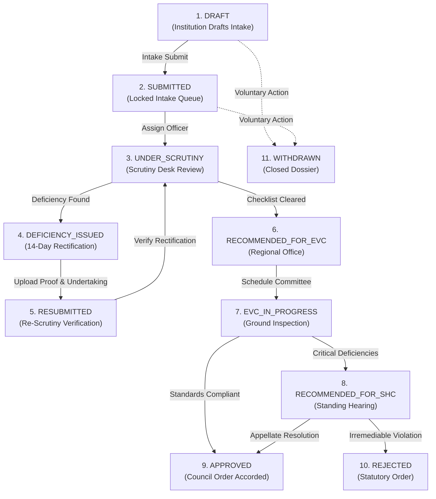
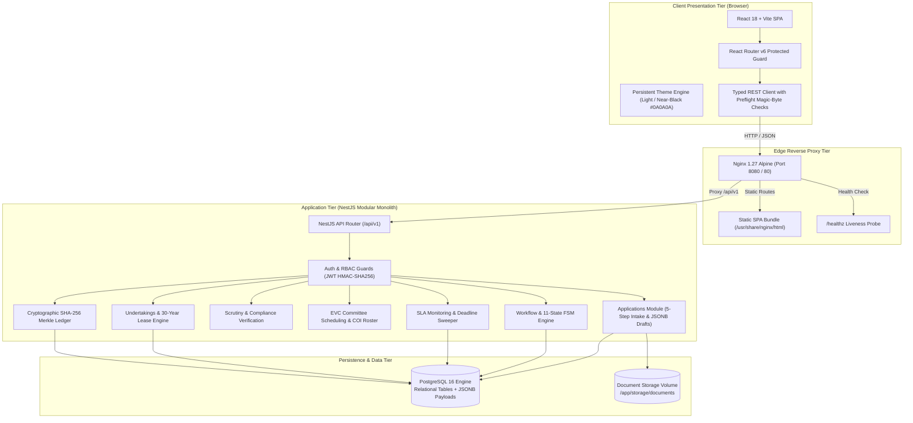

# ApprovalSync — NiyamSetu

### Integrated AICTE Approval Workflow Automation, Scrutiny Management, and Compliance Monitoring System
**Regulation Bureau • All India Council for Technical Education (AICTE)**  
*Smart India Hackathon (SIH) — Problem Statement ID: 26262*

[](https://nestjs.com/)
[](https://react.dev/)
[](https://www.postgresql.org/)
[](#8-cryptographic-audit-ledger--merkle-verification)
[](#10-design-system--accessibility)
[](#19-contributing--licensing)

---

## Table of Contents

1. [Executive Summary & Problem Statement](#1-executive-summary--problem-statement)
2. [Live Production Deployment](#2-live-production-deployment)
3. [Key System Capabilities](#3-key-system-capabilities)
4. [Stakeholder Roles & Access Control](#4-stakeholder-roles--access-control)
5. [End-to-End Approval Lifecycle](#5-end-to-end-approval-lifecycle)
6. [System Architecture](#6-system-architecture)
7. [Technology Stack](#7-technology-stack)
8. [Cryptographic Audit Ledger & Merkle Verification](#8-cryptographic-audit-ledger--merkle-verification)
9. [Time-Bound Undertakings & Lease Engine](#9-time-bound-undertakings--lease-engine)
10. [Design System & Accessibility](#10-design-system--accessibility)
11. [Prerequisites](#11-prerequisites)
12. [Local Installation & Development Setup](#12-local-installation--development-setup)
13. [Environment Configuration](#13-environment-configuration)
14. [Database Management, Migrations & Seeding](#14-database-management-migrations--seeding)
15. [REST API Reference](#15-rest-api-reference)
16. [Testing & Quality Verification](#16-testing--quality-verification)
17. [Docker & AWS EC2 Production Deployment](#17-docker--aws-ec2-production-deployment)
18. [Security Hardening & Safeguards](#18-security-hardening--safeguards)
19. [Troubleshooting Guide](#19-troubleshooting-guide)
20. [Repository Structure](#20-repository-structure)
21. [Contributing & Licensing](#21-contributing--licensing)
22. [Regulatory Disclaimer & Human Sovereignty (ADR-004)](#22-regulatory-disclaimer--human-sovereignty-adr-004)

---

## 1. Executive Summary & Problem Statement

| Attribute | Specification |
| :--- | :--- |
| **Project Code / Repository** | **ApprovalSync** (`Arnz18/ApprovalSync`) |
| **Solution Brand** | **NiyamSetu (नियमसेतु)** — *Regulatory Bridge for Academic Governance* |
| **Problem Statement ID** | **26262** |
| **Title** | **Integrated AICTE Approval Workflow Automation, Compliance Monitoring and Alert Management System** |
| **Organization** | **All India Council for Technical Education (AICTE)** |
| **Department** | **Regulation Bureau** |
| **Category & Theme** | **Software • Smart Automation** |

### The Statutory Challenge
The regulatory approval process for technical institutions across India encompasses a multi-stage governance lifecycle: application drafting, documentary scrutiny, deficiency rectification, Expert Visit Committee (EVC) on-site inspections, Standing Hearing Committee (SHC) reviews, and Executive Council determinations. Under traditional, manual, or fragmented systems, administrative pendency, unmonitored land lease expirations, lack of stage-wise visibility, and communication delays compromise statutory timelines and institutional accountability.

### The Solution: NiyamSetu
**ApprovalSync (NiyamSetu)** provides an enterprise-grade digital operating environment engineered specifically for the AICTE Approval Process Handbook (APH) governance lifecycle:
- **Deterministic 11-State FSM Engine:** Strict state machine preventing unauthorized phase skipping and enforcing required documentary preconditions.
- **Role-Bounded Stakeholder Desks:** Dedicated interfaces for Technical Institutions, Scrutiny Officers, Regional Officers, System Administrators, and Independent Auditors.
- **Draft Resumption & Dynamic Intake:** 5-step application wizard with database-persisted draft progress in PostgreSQL JSONB and instant step resumption.
- **Unified Upload & Magic-Byte Inspection:** Client- and server-side file inspection enforcing magic-byte headers (`%PDF-`, PNG, JPEG), 15 MB boundary constraints, and cryptographic SHA-256 fingerprinting.
- **Consolidated Application Dossier & PDF Print:** Unified dossier combining institution profiles, document matrices, AI anomaly findings, stage movement timelines, and audit ledgers, with clean `@media print` styling and PDF export.
- **Statutory Undertaking & Land Lease Engine:** Validity tracking for registered land deeds (30-year lease with minimum 25-year residual tenure), fire safety NOCs, and affidavits, complete with automated expiration alerts.
- **EVC Inspection Orchestration:** Committee scheduling with randomized expert rosters, mandatory Conflict-of-Interest (COI) declarations, and physical/virtual inspection tracking.
- **Multi-Tier SLA Engine & Automated Sweeper:** Real-time SLA monitoring with multi-tier escalation warnings (Tier 1 approaching, Tier 2 breach, Tier 3 council escalation) and automated deadline sweeps.
- **Tamper-Evident Cryptographic Audit Ledger:** Append-only SHA-256 hash chains and RFC 6962 Merkle tree proofs mathematically detecting database-level tampering.
- **Human Sovereignty (ADR-004):** Automated checks and AI assistance are strictly advisory; all regulatory determinations remain with authorized regulatory officers.

---

## 2. Live Production Deployment

The current production release of ApprovalSync is deployed and accessible on an isolated AWS EC2 production host:

- **Public Web Application:** [http://15.252.122.13:8080](http://15.252.122.13:8080)
- **Nginx Health Probe:** [http://15.252.122.13:8080/healthz](http://15.252.122.13:8080/healthz)
- **Backend Readiness Probe:** [http://15.252.122.13:8080/api/v1/health/readiness](http://15.252.122.13:8080/api/v1/health/readiness)
- **Backend Liveness Probe:** [http://15.252.122.13:8080/api/v1/health/liveness](http://15.252.122.13:8080/api/v1/health/liveness)

*Deployment Details:*
- Configured via `compose.production.yaml` under project name `approvalsync`.
- Published on host port `8080` to safely coexist with existing EC2 services without port collisions.
- PostgreSQL engine (port 5432) and NestJS backend API (port 3000) are internal-only within the isolated Docker bridge network.
- For complete infrastructure maintenance and deployment procedures, see [DEPLOYMENT_AWS_EC2.md](DEPLOYMENT_AWS_EC2.md).

---

## 3. Key System Capabilities

### A. Application Intake Wizard & Draft Resumption (`/applications`)
- **5-Step Structured Flow:** Guides institutions through Basic Information, Programme & Course Selection, Land & Infrastructure Specifications, Statutory Document Uploads, and Declarations.
- **State Persistence:** Form drafts and the active step index serialize directly to PostgreSQL (`payload_jsonb`), enabling users to resume work across sessions, devices, and browser refreshes without data loss.
- **Safe Evidence Upload:** Client-side binary preflight inspects magic-byte signatures (`%PDF-`, `\x89PNG`, `\xFF\xD8\xFF`), limits payloads to 15 MB, and supports one-click replacement.

### B. Regulatory Scrutiny Desk (`/scrutiny`)
- **Documentary Evaluation Queue:** Prioritizes pending applications based on submission date and SLA urgency.
- **APH Checklist Verification:** Interactive verification of required documentation against codified Approval Process Handbook norms.
- **Deficiency Communication:** Allows officers to flag non-compliant items, record mandatory statutory rationales, and issue formal deficiency notices.

### C. Consolidated Application Dossier & PDF Export (`/dossier/:id`)
- **Unified Evidence Report:** Consolidates institutional data, uploaded files, AI anomaly scores, timeline movements, and undertakings into a multi-tab view.
- **Clean Print & PDF Styling:** Dedicated `@media print` stylesheets suppress UI clutter, navigation bars, and action buttons to generate an executive dossier for council committees.

### D. EVC Inspection Orchestration (`/evc`)
- **Committee Assignment:** Allocates a 3-member Expert Visit Committee (Chairman, Subject Expert, Architect/Civil Expert).
- **Conflict-of-Interest (COI) Guard:** Requires affirmative COI declarations before visit confirmation to ensure unbiased ground inspections.
- **Visit Disposition:** Supports on-site and hybrid evaluations, with structured recording of site findings and recommendations.

### E. Multi-Tier SLA Monitoring & Deadline Sweeper (`/dashboard`)
- **Tiered Escalations:**
  - *Tier 1:* RO alert when 80% of a review window has elapsed.
  - *Tier 2:* Bureau breach notice when 100% of the turnaround window is reached.
  - *Tier 3:* Executive council escalation on persistent pendency.
- **Automated Sweeper:** Executes background deadline checks (`POST /api/v1/notifications/sweep`) and pushes alerts into the notification feed.

### F. Time-Bound Undertaking & Land Lease Management (`/undertakings`)
- **Statutory Land Validation:** Automatically verifies land leases against AICTE's requirement of a 30-year registered lease with at least 25 years of residual validity.
- **Renewal Alerting:** Proactively surfaces warnings 180, 90, and 30 days before statutory document expirations.

---

## 4. Stakeholder Roles & Access Control

The platform enforces Role-Based Access Control (RBAC) across client routes and server-side endpoints.

| Role | Portal Desk | Verified Evaluation Email | Designated Landing | Primary Capabilities |
| :--- | :--- | :--- | :--- | :--- |
| **Technical Institution** | Applicant Portal | `demo.institution@synthetic.approvalsync.local` | `/dashboard` *(Institution View)* | Draft applications, resume progress, upload proofs, view deficiencies, track leases |
| **Scrutiny Officer** | Scrutiny Desk | `demo.scrutiny@synthetic.approvalsync.local` | `/scrutiny` *(Review Queue)* | Inspect documents against APH checklists, record findings, issue deficiency notices |
| **Regional Officer** | Regional Operations | `demo.regional@synthetic.approvalsync.local` | `/dashboard` *(Regional Console)* | Regional case overview, schedule EVC inspections, assign expert rosters, monitor SLAs |
| **System Administrator** | Admin Console | `demo.admin@synthetic.approvalsync.local` | `/dashboard` *(Admin Console)* | Global pendency metrics, SLA threshold configuration, trigger deadline sweeps, audit logs |
| **Independent Auditor** | Compliance Vigilance | `auditor@synthetic.approvalsync.local` | `/audit` *(Audit Ledger)* | Read-only inspection of SHA-256 hash chains, Merkle root verification, tamper detection |

> **Evaluation Password:** All pre-seeded demonstration accounts use the password: `DemoPass@123`  
> **Interactive Login Desk:** The `/login` page includes interactive role cards that pre-fill these credentials with a single click.  
> **Evaluator Walkthrough:** For complete step-by-step test scripts and scenarios, consult [docs/EVALUATOR_DEMO_AND_TROUBLESHOOTING.md](docs/EVALUATOR_DEMO_AND_TROUBLESHOOTING.md).

---

## 5. End-to-End Approval Lifecycle

The lifecycle follows a deterministic 11-state Finite State Machine (FSM):



---

## 6. System Architecture



---

## 7. Technology Stack

### Frontend Architecture
- **Framework & Runtime:** React 18.3, TypeScript 5.5, Vite 5.4.
- **Routing & State:** React Router DOM 6.26, React Context API.
- **Icons & Visuals:** Lucide React.
- **Testing:** Vitest 2.1, React Testing Library, JSDOM.
- **Styling:** CSS variables, design token system, zero-runtime overhead, persistent dark mode.

### Backend Architecture
- **Framework & Runtime:** NestJS 10.3, TypeScript 5.3, Node.js LTS (v20 / v22).
- **Database & ORM:** PostgreSQL 16, TypeORM 0.3.
- **Authentication:** Passport-JWT, bcrypt, HMAC-SHA256 token verification.
- **Validation & Serialization:** Class-Validator 0.14, Class-Transformer 0.5.
- **API Documentation:** Swagger / OpenAPI 3.0 via `@nestjs/swagger`.
- **Testing:** Jest 29, Supertest 6, ts-jest.

### Deployment & Infrastructure
- **Containerization:** Docker multi-stage builds (Alpine-based Node 22 and Nginx 1.27).
- **Orchestration:** Docker Compose v2.
- **Production Host:** AWS EC2 (Ubuntu 24.04/26.04 LTS, x86_64, Mumbai `ap-south-1`).
- **Isolation Policy:** Named project `approvalsync`, internal bridge network, non-overlapping host port (`8080`).

---

## 8. Cryptographic Audit Ledger & Merkle Verification

To prevent unauthorized modification of regulatory decisions, ApprovalSync implements an append-only cryptographic audit ledger:

1. **Sequential SHA-256 Hash Chaining:** Every state transition and regulatory determination computes a cryptographic hash over the event payload, timestamp, actor ID, and previous record hash (`parentHash`).
2. **RFC 6962 Merkle Trees:** Events are grouped into verifiable blocks with Merkle roots, enabling independent auditors to verify the integrity of any historical decision.
3. **Tamper Detection:** Modifying any historical database row breaks the hash chain, immediately alerting compliance officers upon ledger verification.

---

## 9. Time-Bound Undertakings & Lease Engine

AICTE regulations require technical campuses operating on leased land to maintain a registered lease of at least 30 years duration with at least 25 years of residual validity. The Undertakings Engine enforces this:

- **Automated Residual Calculation:** Calculates exact elapsed and residual lease durations based on registered commencement dates.
- **Statutory Expiration Warnings:** Emits notifications when an undertaking or lease enters critical renewal windows (180 days, 90 days, 30 days).
- **Deficiency Association:** Flags institutions failing the 25-year residual threshold as deficient during documentary scrutiny.

---

## 10. Design System & Accessibility

NiyamSetu implements an accessible design system with persistent theme support:

| Token | Light Theme | Dark Theme (`data-theme="dark"`) | Usage |
| :--- | :--- | :--- | :--- |
| `--color-background` | `#f8fafc` | `#0A0A0A` | Main page background |
| `--color-header-bg` | `#ffffff` | `#111111` | Sticky top navigation bar |
| `--color-surface` | `#ffffff` | `#181818` | Cards, panels, modal dialogs |
| `--color-muted` | `#f1f5f9` | `#202020` | Input wells, tab tracks |
| `--color-foreground` | `#0f172a` | `#F5F5F5` | Primary body text |
| `--color-border` | `#cbd5e1` | `#303030` | Structural dividers |
| `--color-primary` | `#1e3a5f` | `#4D8DFF` | Primary actions and accents |

- **Zero Theme Flash (Anti-FOUC):** An inline script in `index.html` resolves the stored theme before stylesheet rendering.
- **Accessible Slider Controls:** Theme toggles use accessible `role="switch"` semantics with keyboard navigation (`Enter` / `Space`).
- **Responsive Layout:** Dynamic sidebars and scroll-safe tables ensure usability across desktop monitors and tablet displays.

---

## 11. Prerequisites

To run or develop ApprovalSync locally, ensure your machine has:

- **Node.js:** v18.x or v20.x LTS (compatible with Node 22)
- **npm:** v9.x or v10.x
- **Docker Desktop:** v4.20+ with Docker Compose v2
- **Git**

---

## 12. Local Installation & Development Setup

### Step 1: Clone the Repository
```bash
git clone https://github.com/Arnz18/ApprovalSync.git
cd ApprovalSync
```

### Step 2: Configure Environment Files
Copy the development environment templates:
```bash
# Backend environment
cp .env.example backend/.env

# Frontend environment
cp frontend/.env.example frontend/.env
```

### Step 3: Start the Development PostgreSQL Container
The repository provides a development Compose file (`compose.yaml`) configured to run PostgreSQL 16 on port `5434` (to avoid conflicts with any local PostgreSQL instance on 5432):
```bash
docker compose up -d
docker compose ps
```

### Step 4: Setup and Start the Backend
```bash
cd backend

# Install dependencies
npm ci

# Execute TypeORM database migrations
npm run migration:run

# Populate synthetic demonstration data
npm run seed

# Start NestJS in watch mode (http://localhost:3000)
npm run start:dev
```

### Step 5: Start the Frontend
In a new terminal window:
```bash
cd frontend

# Install dependencies
npm ci

# Start Vite development server (http://localhost:5173)
npm run dev
```

### Step 6: Verify Local Installation
- **Application Portal:** [http://localhost:5173](http://localhost:5173)
- **Backend API:** [http://localhost:3000](http://localhost:3000)
- **Health Check:** [http://localhost:3000/api/v1/health](http://localhost:3000/api/v1/health)
- **Swagger Documentation:** [http://localhost:3000/api/docs](http://localhost:3000/api/docs)

---

## 13. Environment Configuration

### Backend Configuration Reference (`backend/.env`)

| Variable | Required | Default / Example | Purpose |
| :--- | :--- | :--- | :--- |
| `PORT` | No | `3000` | Port for the NestJS HTTP listener |
| `NODE_ENV` | Yes | `development` | Runtime environment (`development`, `test`, `production`) |
| `API_PREFIX` | No | `api/v1` | Global REST endpoint route prefix |
| `DB_HOST` | Yes | `127.0.0.1` | PostgreSQL database host |
| `DB_PORT` | Yes | `5434` | PostgreSQL port (5434 in dev compose, 5432 in prod) |
| `DB_NAME` | Yes | `approvalsync` | Database name |
| `DB_USER` | Yes | `postgres` | Database username |
| `DB_PASSWORD` | Yes | `postgres_dev_password` | Database password (dev default strictly rejected in production) |
| `JWT_SECRET` | Yes | *32+ char secret* | Cryptographic HMAC secret for signing access tokens |
| `JWT_EXPIRES_IN` | No | `3600s` | Access token validity duration |
| `CORS_ORIGINS` | No | `http://localhost:5173` | Comma-separated list of permitted browser origins |
| `LOG_LEVEL` | No | `info` | Logger verbosity (`debug`, `info`, `warn`, `error`) |
| `ENABLE_SWAGGER` | No | `false` | Enables Swagger UI at `/api/docs` (default true in development) |

### Frontend Configuration Reference (`frontend/.env`)

| Variable | Required | Default / Example | Purpose |
| :--- | :--- | :--- | :--- |
| `VITE_API_BASE_URL` | Yes | `/api/v1` or `http://localhost:3000` | Base endpoint for REST calls |
| `VITE_API_TIMEOUT_MS` | No | `15000` | API request timeout in milliseconds |
| `VITE_APP_ENV` | No | `development` | Application environment label |

---

## 14. Database Management, Migrations & Seeding

The application uses TypeORM migrations for schema versioning.

### Running Migrations
```bash
cd backend

# Development (executes TypeScript migrations)
npm run migration:run

# Revert latest migration
npm run migration:revert

# Production (executes compiled JavaScript migrations)
npm run migration:run:prod
```

### Seeding Demonstration Data
```bash
cd backend

# Development
npm run seed

# Production (inside container)
node dist/database/seeds/run-seed.js
```

### Data Safety & Retention
- In production, data is stored in named Docker volumes: `approvalsync_postgres_data` and `approvalsync_storage_data`.
- **Do not run `docker compose down -v`** in production, as this permanently deletes volume data.

---

## 15. REST API Reference

All application endpoints are served under the `/api/v1` prefix.

### Authentication & Profiles
| Method | Endpoint | Access | Description |
| :--- | :--- | :--- | :--- |
| `POST` | `/api/v1/auth/login` | Public | Authenticates credentials and returns a JWT bearer token |
| `GET` | `/api/v1/auth/me` | Authenticated | Retrieves current authenticated profile and assigned role |

### Applications & Dossier Management
| Method | Endpoint | Access | Description |
| :--- | :--- | :--- | :--- |
| `GET` | `/api/v1/applications` | Role-bounded | Lists accessible applications |
| `POST` | `/api/v1/applications` | Institution | Creates and saves a new application draft |
| `GET` | `/api/v1/applications/:id` | Role-bounded | Retrieves application details and persisted draft state |
| `PATCH` | `/api/v1/applications/:id` | Institution | Persists form inputs and active wizard step index |
| `POST` | `/api/v1/applications/:id/submit` | Institution | Submits application and advances state to `SUBMITTED` |
| `GET` | `/api/v1/applications/:id/dossier-report` | Authenticated | Generates consolidated verification dossier |

### Workflow Transitions & EVC Scheduling
| Method | Endpoint | Access | Description |
| :--- | :--- | :--- | :--- |
| `POST` | `/api/v1/applications/:id/transitions` | Authorized Roles | Executes deterministic FSM state transition |
| `GET` | `/api/v1/applications/:id/allowed-transitions` | Authenticated | Lists valid target states based on current status |
| `GET` | `/api/v1/workflow/stage-pendency` | Admin / RO | Retrieves stage-wise case distribution and pendency |
| `GET` | `/api/v1/applications/:id/evc-schedule` | Regional / Officer | Retrieves scheduled inspection committee details |
| `POST` | `/api/v1/applications/:id/evc-schedule` | Regional Officer | Schedules EVC on-site visit and records COI affirmations |
| `GET` | `/api/v1/evc/schedules` | Regional Officer | Lists all scheduled regional inspection visits |

### Undertakings & Leases
| Method | Endpoint | Access | Description |
| :--- | :--- | :--- | :--- |
| `GET` | `/api/v1/undertakings` | Authenticated | Lists institutional undertakings and land lease deeds |
| `POST` | `/api/v1/undertakings` | Institution | Registers a new lease deed or statutory affidavit |
| `POST` | `/api/v1/undertakings/reconcile` | Admin / System | Reconciles validity statuses and calculates residual tenure |

### Notifications & SLA Monitoring
| Method | Endpoint | Access | Description |
| :--- | :--- | :--- | :--- |
| `GET` | `/api/v1/notifications` | Authenticated | Retrieves user notifications and escalation warnings |
| `PATCH` | `/api/v1/notifications/:id/read` | Authenticated | Marks a specific notification as read |
| `POST` | `/api/v1/notifications/sweep` | System Admin | Executes on-demand deadline sweep across active timers |
| `GET` | `/api/v1/applications/:id/sla-timers` | Authenticated | Retrieves SLA timers and breach statuses for an application |

### Cryptographic Audit Ledger
| Method | Endpoint | Access | Description |
| :--- | :--- | :--- | :--- |
| `GET` | `/api/v1/applications/:id/audit-logs` | Auditor / Admin | Retrieves append-only SHA-256 audit log events |
| `GET` | `/api/v1/applications/:id/audit-logs/verify` | Auditor / Admin | Verifies sequential hash-chain integrity for an application |

### System Health
| Method | Endpoint | Access | Description |
| :--- | :--- | :--- | :--- |
| `GET` | `/api/v1/health` | Public | General health status probe |
| `GET` | `/api/v1/health/liveness` | Public | Container liveness check |
| `GET` | `/api/v1/health/readiness` | Public | Readiness check verifying PostgreSQL database connectivity |

---

## 16. Testing & Quality Verification

ApprovalSync maintains automated test suites across both frontend and backend codebases.

### Frontend Quality Verification
```bash
cd frontend

# Run unit and component test suite (Vitest)
npm run test

# Run TypeScript compiler check
npm run typecheck

# Run ESLint validation
npm run lint

# Run Prettier style check
npm run format:check
```
*Current Status:* **35 test suites passing, 278 individual tests passing, 0 lint warnings.**

### Backend Quality Verification
```bash
cd backend

# Run unit test suite (Jest - standalone, no database required)
npm run test

# Run End-to-End integration tests (requires local PostgreSQL container running on port 5434)
npm run test:e2e

# Run ESLint validation
npm run lint

# Run Prettier style check
npm run format:check

# Compile production build
npm run build
```
*Current Status:* **65 unit test suites passing, 602 individual unit tests passing, clean TypeScript compilation, 0 lint warnings.**

---

## 17. Docker & AWS EC2 Production Deployment

The production topology is defined in `compose.production.yaml`.

### Services Overview
1. **`postgres`:** PostgreSQL 16 Alpine container with healthchecks, unexposed to host networks.
2. **`backend`:** Multi-stage Node 22 Alpine container running the NestJS application via `dumb-init`.
3. **`frontend`:** Multi-stage Nginx 1.27 Alpine container serving static SPA assets and reverse-proxying `/api/` traffic to the backend.

### Deployment on EC2 Host
```bash
# Navigate to the deployment directory
cd ~/approvalsync

# Ensure production environment is configured
cp .env.production.example .env.production
chmod 600 .env.production
# (Edit .env.production with strong DB_PASSWORD and JWT_SECRET)

# Build production container images
docker compose -p approvalsync -f compose.production.yaml --env-file .env.production build

# Execute database migrations
docker compose -p approvalsync -f compose.production.yaml --env-file .env.production run --rm backend node dist/database/run-migrations.js

# Start or recreate production containers
docker compose -p approvalsync -f compose.production.yaml --env-file .env.production up -d

# Verify container health
docker compose -p approvalsync -f compose.production.yaml --env-file .env.production ps
```

*For complete operational instructions, database backup procedures, and rolling updates, refer to [DEPLOYMENT_AWS_EC2.md](DEPLOYMENT_AWS_EC2.md).*

---

## 18. Security Hardening & Safeguards

- **Strict Internal Network Isolation:** The PostgreSQL database (5432) and NestJS backend (3000) are attached only to the internal Docker bridge network (`approvalsync_net`) and are never exposed to public host ports.
- **Production Secret Validation:** The backend startup validator (`config.validation.ts`) strictly rejects default, weak, or short secrets (`DB_PASSWORD` and `JWT_SECRET`) when `NODE_ENV=production`.
- **Upload Content Security:** Storage adapters enforce path sanitization preventing path traversal attacks. Uploaded files undergo binary magic-byte inspection before ingestion.
- **Statutory Human Sovereignty (ADR-004):** Automated algorithms and AI OCR models provide decision support only. All statutory approvals, rejections, and deficiency notices require deliberate human review and authorization.

---

## 19. Troubleshooting Guide

### Issue 1: Login returns "Unable to connect to the authentication service"
- **Cause:** The backend API is not running or the reverse proxy target is unreachable.
- **Solution:**
  1. Confirm the backend container is healthy: `docker compose ps`
  2. Inspect backend logs: `docker compose logs backend --tail=50`
  3. Verify `VITE_API_BASE_URL` in `frontend/.env` is configured correctly.

### Issue 2: Development PostgreSQL port conflict on port 5434
- **Cause:** Another process or leftover container is bound to port `5434`.
- **Solution:**
  1. Check running containers: `docker ps`
  2. Stop any stale containers: `docker stop approvalsync-postgres`
  3. Restart via `docker compose up -d`.

### Issue 3: Backend tests fail on `setup-test-db.spec.ts`
- **Cause:** Database integration tests require a live PostgreSQL container.
- **Solution:**
  1. Start the local database: `docker compose up -d`
  2. Re-run tests: `npm run test` or `npm run test:e2e`.

### Issue 4: Upload rejected with "Header signature does not match"
- **Cause:** Magic-byte inspection detected a file extension mismatch (e.g. a renamed `.txt` or `.exe` file).
- **Solution:** Upload genuine PDF files starting with the `%PDF-` header, or valid PNG/JPEG images under the 15 MB threshold.

---

## 20. Repository Structure

```text
ApprovalSync/
├── .github/                   # GitHub Actions CI workflow definitions
├── backend/                   # NestJS Modular Monolith API
│   ├── src/
│   │   ├── ai/                # Document classification and OCR extraction services
│   │   ├── applications/      # Intake wizard, draft persistence, and dossier logic
│   │   ├── audit/             # Cryptographic SHA-256 hash chains and Merkle ledger
│   │   ├── auth/              # JWT authentication, bcrypt hashing, and role guards
│   │   ├── compliance/        # APH compliance assistance and review checks
│   │   ├── config/            # Environment factories and strict production validators
│   │   ├── database/          # TypeORM entities, migrations, and seed scripts
│   │   ├── documents/         # Upload sanitization, magic-byte inspection, storage
│   │   ├── health/            # Liveness and database readiness probe controllers
│   │   ├── notifications/     # Notification engine and automated deadline sweeper
│   │   ├── rules/             # Approval Process Handbook codified rule sets
│   │   ├── sla/               # SLA timer monitoring and multi-tier escalation
│   │   ├── undertakings/      # 30-year land lease and statutory affidavit engine
│   │   └── workflow/          # 11-State Finite State Machine and EVC scheduling
│   ├── test/                  # End-to-end integration test suites
│   ├── Dockerfile             # Multi-stage production container build
│   └── package.json           # Backend dependencies and test scripts
├── frontend/                  # React 18 + Vite Single Page Application
│   ├── src/
│   │   ├── api/               # Typed REST API service clients
│   │   ├── auth/              # Auth context, route permissions, and protected guards
│   │   ├── components/        # Design system UI, intake wizard steps, EVC scheduler
│   │   ├── context/           # User preferences and persistent theme state
│   │   ├── pages/             # Role dashboards, scrutiny queue, login, dossier view
│   │   ├── routes/            # App route definitions and navigation hierarchy
│   │   └── styles/            # CSS tokens, layout classes, and dark theme definitions
│   ├── nginx.conf             # Production reverse proxy and SPA routing configuration
│   ├── Dockerfile             # Multi-stage frontend container build with Nginx
│   └── package.json           # Frontend dependencies, Vitest scripts, and linters
├── docs/                      # Technical specifications, QA audit reports, and guides
│   ├── architecture/          # Architecture decisions (ADR-004) and threat model
│   ├── qa/                    # Full-stack audit, UI remediation, mobile QA reports
│   └── EVALUATOR_DEMO_AND_TROUBLESHOOTING.md # Detailed evaluator walk-through script
├── compose.yaml               # Local development PostgreSQL 16 Compose service
├── compose.production.yaml    # Production 3-tier isolated Compose stack for AWS EC2
├── DEPLOYMENT_AWS_EC2.md      # AWS EC2 deployment, backup, and maintenance runbook
├── .env.example               # Development environment variable template
├── .env.production.example    # Production environment variable template
└── README.md                  # Project documentation and architectural overview
```

---

## 21. Contributing & Licensing

### Contributing
Contributions to ApprovalSync are welcome. Please adhere to the following workflow:
1. Create a feature branch from `main`: `git checkout -b feature/your-feature-name`
2. Ensure all quality gates pass before opening a pull request:
   - Frontend: `npm run test`, `npm run typecheck`, `npm run lint`
   - Backend: `npm run test`, `npm run lint`, `npm run build`
3. Submit a Pull Request with a clear description of the regulatory or technical enhancement.

### Licensing
This repository was developed as part of the **Smart India Hackathon (SIH)** for the **All India Council for Technical Education (AICTE)**. Formal open-source licensing terms will be specified upon council review. All rights are reserved by the development team and participating regulatory bodies pending official licensing.

---

## 22. Regulatory Disclaimer & Human Sovereignty (ADR-004)

> [!IMPORTANT]
> **Advisory Nature & Synthetic Demonstration Data:**  
> ApprovalSync (NiyamSetu) operates as a regulatory decision-support and workflow automation platform. All pre-seeded institutions, personnel records, application identifiers, and attached documents are synthetic artifacts designed for evaluation and demonstration purposes.
> 
> Under **ADR-004 (Human Sovereignty Principle)**, automated validation rules, OCR extractions, anomaly detection flags, and SLA timers provide decision assistance only. All statutory determinations—including deficiency notices, EVC inspection outcomes, and final approval orders—remain strictly with authorized human regulatory officers under AICTE Approval Process Handbook (APH) governance.
