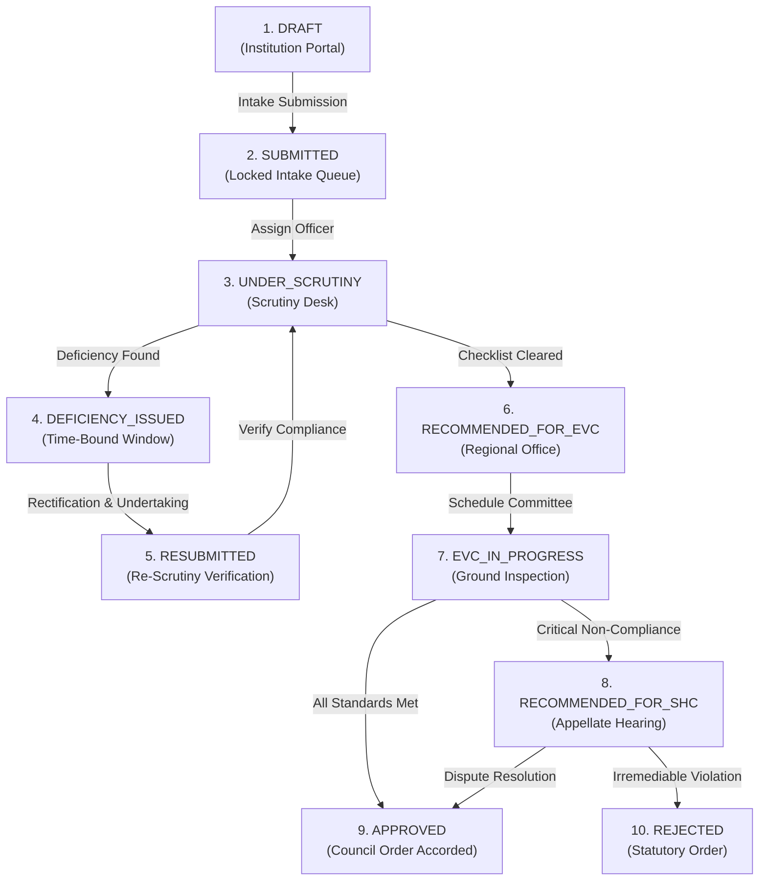

# NiyamSetu — Approval & Compliance Management System
### Integrated AICTE Approval Workflow Automation, Compliance Monitoring, and Alert Management System
**Regulation Bureau • All India Council for Technical Education (AICTE)** • *Smart India Hackathon — Problem Statement ID: 26262*

[](https://nestjs.com/)
[](https://react.dev/)
[](https://www.postgresql.org/)
[](#cryptographic-audit-trail--merkle-ledger)
[](#design-system--dark-mode)
[](https://github.com/Arnz18/ApprovalSync/actions)

---

## 1. Executive Summary & Problem Statement Alignment

| Attribute | Specification |
| :--- | :--- |
| **Product Name** | **NiyamSetu (नियमसेतु)** — *The Regulatory Bridge for Academic Governance* |
| **Problem Statement ID** | **26262** |
| **Title** | **Integrated AICTE Approval Workflow Automation, Compliance Monitoring and Alert Management System** |
| **Organization** | **All India Council for Technical Education (AICTE)** |
| **Department** | **Regulation Bureau** |
| **Category** | **Software** |
| **Theme** | **Smart Automation** |

### The Challenge
The regulatory approval process for technical institutions across India encompasses a rigorous, multi-stage governance lifecycle: application drafting, documentary scrutiny, deficiency rectification, Expert Visit Committee (EVC) on-site inspections, Standing Hearing Committee (SHC) reviews, and Executive Committee approvals. Under manual and fragmented processes, administrative pendency, unmonitored undertaking expirations, lack of transparent stage-wise visibility, and communication delays can compromise statutory timelines.

### The Solution: NiyamSetu
**NiyamSetu** delivers an enterprise-grade digital operating environment that automates, secures, and tracks technical institution approval workflows from initial intake to final council determination:
1. **Deterministic State Machine Enforcement:** A 16-state Finite State Machine (FSM) enforcing rigorous transition prerequisites and preventing unauthorized stage jumping.
2. **Multi-Role Portal Desks:** Dedicated, permission-bounded workspaces tailored specifically for Technical Institutions, Scrutiny Officers, Regional Officers, System Administrators, and Independent Auditors.
3. **Application Intake Wizard with Draft Resumption:** 5-step intake wizard with database-persisted progress, step-level auto-saving, and seamless resumption via dashboard shortcuts or deep links.
4. **Unified Evidence Upload Control:** Single accessible file component enforcing magic-byte inspection (%PDF-, \x89PNG, \xFF\xD8\xFF), 15 MB boundary checks, and one-click file replacement.
5. **Consolidated Application Dossier & PDF Print:** Unified evidence report integrating institution profiles, document matrices, AI anomaly findings, stage movement timelines, and audit ledgers, with clean `@media print` layout and PDF export.
6. **Time-Bound Undertaking & Lease Expiry Engine:** Automated validity tracking for institutional land deeds, registered leases (minimum 30-year requirement), and compliance undertakings with proactive expiration alerts.
7. **EVC Inspection Orchestration:** Committee scheduling with conflict-of-interest declarations, randomized expert rosters, and inspection record management.
8. **Multi-Tier SLA Hierarchy & Alert Engine:** Real-time SLA monitoring with multi-tier escalation warnings (Tier 1 approaching, Tier 2 breach, Tier 3 committee escalation) and automated deadline sweeps.
9. **Tamper-Evident Cryptographic Audit Ledger:** Sequential SHA-256 hash-chaining and Merkle tree roots (RFC 6962) mathematically detecting any direct database tampering.

---

## 2. Design System & Dark Mode

NiyamSetu adheres to high-contrast, accessible visual hierarchy standards designed for intensive statutory review workflows:

### Color Palette Tokens
| Token | Light Theme | Dark Theme (`data-theme="dark"`) | Usage |
| :--- | :--- | :--- | :--- |
| `--color-background` | `#f8fafc` | `#0A0A0A` | Main page background |
| `--color-header-bg` | `#ffffff` | `#111111` | Persistent top navigation header |
| `--color-sidebar-bg` | `#ffffff` | `#111111` | Primary navigation sidebar |
| `--color-surface` | `#ffffff` | `#181818` | Cards, panels, and modal containers |
| `--color-muted` | `#f1f5f9` | `#202020` | Secondary wells, inputs, and tab tracks |
| `--color-foreground` | `#0f172a` | `#F5F5F5` | Primary high-contrast body text |
| `--color-muted-foreground` | `#64748b` | `#B3B3B3` | Secondary labels and helper text |
| `--color-border` | `#cbd5e1` | `#303030` | Structural borders and dividers |
| `--color-primary` | `#1e3a5f` | `#4D8DFF` | Interactive buttons and accent highlights |

### UX Polish Highlights
- **Persistent Animated Dark Mode Switch:** Accessible slider switch (`role="switch"`, `aria-checked`) with smooth thumb transition, keyboard activation (`Enter` / `Space`), and anti-FOUC inline script in `index.html`.
- **Focal Login Hierarchy:** Centered sign-in card with prominent brand identity, email/password fields, and submit action, followed by a clearly separated 4-portal selector grid below the form.
- **Stabilized Sticky Header:** Fixed-height header (`var(--header-height, 4rem)`), solid background with `backdrop-filter: blur(8px)`, zero layout jitter, and overflow prevention on the main content area.
- **Unified Upload Component:** Single polished file control eliminating duplicate native inputs, featuring file size indicators, upload progress animations, and one-click replacement.

---

## 3. Stakeholder Roles & Access Matrix

| Stakeholder Role | Portal Identifier | Pre-Seeded Login Email | Designated Landing Route | Key Capabilities |
| :--- | :--- | :--- | :--- | :--- |
| **Technical Institution** | Applicant Portal | `institution@niyamsetu.gov.in` | `/dashboard` *(My Applications)* | Multi-step intake wizard, draft resumption, deficiency response, undertakings & lease registration |
| **Scrutiny Officer** | Evaluation Bureau | `scrutiny@niyamsetu.gov.in` | `/scrutiny` *(Scrutiny Desk)* | Documentary scrutiny queue, APH checklist validation, deficiency notice issuance, re-scrutiny |
| **Regional Officer** | Regional Operations | `regional@niyamsetu.gov.in` | `/dashboard` *(Regional Console)* | Regional case movement oversight, EVC committee scheduling, expert roster management, SLA escalations |
| **System Administrator** | Administrative Council | `admin@niyamsetu.gov.in` | `/dashboard` *(Admin Console)* | Global stage pendency monitor, SLA policy configuration, on-demand deadline sweeps, audit ledger |
| **Independent Auditor** | Compliance Vigilance | `auditor@synthetic.approvalsync.local` | `/audit` *(Audit Ledger)* | Read-only cryptographic proof inspection, Merkle root verification, tamper detection |

> **Synthetic Password Note:** All pre-seeded demonstration accounts share the synthetic password `DemoPass@123`.

---

## 4. End-to-End Approval Lifecycle Walkthrough



### Stage Milestones
1. **Intake & Draft Preparation (`/applications`):**
   - Institutions complete a 5-step intake wizard covering Basic Details, Programme/Course Selection, Land & Physical Infrastructure, Prescribed Document Uploads, and Statutory Declarations.
   - Saves current step index and form state to PostgreSQL `payload_jsonb` column on each step advance.
2. **Primary Scrutiny Desk (`/scrutiny`):**
   - AICTE Scrutiny Officers inspect uploaded proofs against versioned Approval Process Handbook (APH) checklists.
   - An advisory Document AI engine provides optical character recognition and duplicate detection assistance while preserving strict **Human Sovereignty (ADR-004)**.
3. **Deficiency Rectification & Undertaking Management (`/undertakings`):**
   - When deficiencies are communicated, institutions receive an automated notification and a time-bound compliance undertaking window (e.g., 14 days).
   - Institutions upload corrective documentation and statutory affidavits.
4. **Expert Visit Committee Scheduling & Inspection (`/evc`):**
   - Regional Officers review the approved scrutiny dossier and initiate committee scheduling.
   - An expert roster assigns a 3-member committee (Chairman, Subject Expert, Architect/Civil Expert).
   - Mandatory Conflict-of-Interest (COI) declarations prevent institutional bias.
5. **Application Dossier Evidence Report (`/dossier/:id`):**
   - Comprehensive multi-tab consolidated report combining application profile, documentary evidence matrix, AI findings, chronological audit timeline, and undertakings.
   - Printable with `@media print` layout and PDF export.

---

## 5. System Architecture

```
                                  +-------------------------------------------------------------+
                                  |                     Browser Client Layer                    |
                                  |         React 18 + Vite SPA • NiyamSetu Design System       |
                                  +------------------------------+------------------------------+
                                                                 | REST / SSE (Port 5173 -> 3000)
                                                                 v
                                  +-------------------------------------------------------------+
                                  |                     NestJS Backend Engine                   |
                                  |           Modular Monolith Architecture (Port 3000)         |
                                  +------------------------------+------------------------------+
                                                                 |
               +-----------------------+-------------------------+-------------------------+-----------------------+
               |                       |                         |                         |                       |
               v                       v                         v                         v                       v
+-----------------------------+ +---------------------+ +---------------------+ +---------------------+ +---------------------+
|     Applications Module     | |   Workflow & FSM    | |  Notifications/SLA  | |  Undertakings Module| |    Audit Ledger     |
| - 5-Step Intake Wizard      | | - 16-State FSM Core | | - Multi-Tier Alerts | | - Registered Leases | | - SHA-256 Event Chain |
| - Dynamic JSONB Draft State | | - EVC Scheduling    | | - Deadline Sweeper  | | - Expiry Calculator | | - Merkle Tree RFC6962 |
| - Magic-Byte Sanitization   | | - Stage Movement    | | - SSE Event Streams | | - Compliance Tracking| | - Immutability Guard |
+--------------+--------------+ +----------+----------+ +----------+----------+ +----------+----------+ +----------+----------+
               |                           |                       |                       |                       |
               +---------------------------+-----------------------+-----------------------+-----------------------+
                                                                   |
                                                                   v
                                  +-------------------------------------------------------------+
                                  |                 PostgreSQL 16 Database Engine               |
                                  |             Docker Container: approvalsync-postgres          |
                                  |                     Port: 127.0.0.1:5434                    |
                                  +-------------------------------------------------------------+
```

---

## 6. Local Quickstart

### Prerequisites
- **Node.js:** v18.x or v20.x LTS
- **npm:** v9.x or v10.x
- **Docker Desktop:** v4.20+ with Docker Compose
- **Git**

### Step 1: Start PostgreSQL Container
```bash
# Clone the repository
git clone https://github.com/Arnz18/ApprovalSync.git
cd ApprovalSync

# Start PostgreSQL 16 container via Docker Compose
docker compose up -d

# Verify container health (running on port 5434)
docker compose ps
```

### Step 2: Start Backend
```bash
cd backend

# Install dependencies
npm ci

# Run database migrations
npm run migration:run

# Populate seed demonstration data
npm run seed

# Start NestJS development server (http://localhost:3000)
npm run start:dev
```

### Step 3: Start Frontend
```bash
# Open a separate terminal
cd frontend

# Install dependencies
npm ci

# Start Vite development server (http://localhost:5173)
npm run dev
```

### Step 4: Access the Application
- **NiyamSetu Portal:** [http://localhost:5173](http://localhost:5173)
- **Backend API:** [http://localhost:3000](http://localhost:3000)
- **Swagger Documentation:** [http://localhost:3000/api/docs](http://localhost:3000/api/docs)
- **Health Check:** [http://localhost:3000/api/v1/health](http://localhost:3000/api/v1/health)

---

## 7. Environment Variables Configuration

### Backend (`backend/.env`)
| Variable | Value | Description |
| :--- | :--- | :--- |
| `PORT` | `3000` | Port for the NestJS HTTP server |
| `DB_HOST` | `127.0.0.1` | Database host address |
| `DB_PORT` | `5434` | PostgreSQL container external mapped port |
| `DB_USERNAME` | `aicte_admin` | Database username |
| `DB_PASSWORD` | `aicte_secure_pass_2026` | Database password |
| `DB_NAME` | `aicte_workflow_db` | Primary database name |
| `JWT_SECRET` | `synthetic_jwt_secret_aicte_ps26262` | Secret key for signing JWT bearer tokens |
| `JWT_EXPIRES_IN` | `24h` | Token expiration duration |

### Frontend (`frontend/.env`)
| Variable | Value | Description |
| :--- | :--- | :--- |
| `VITE_API_BASE_URL` | `http://localhost:3000` | Target backend REST API base URL |
| `VITE_ENABLE_DEMO_PANEL` | `true` | Enables role pre-fill selector cards on login page |

---

## 8. Primary REST API Endpoints

| Method | Endpoint | Clearance | Description |
| :--- | :--- | :--- | :--- |
| `POST` | `/api/v1/auth/login` | Public | Authenticates credentials and returns JWT token |
| `GET` | `/api/v1/auth/me` | Authenticated | Retrieves profile of currently authenticated user |
| `GET` | `/api/v1/applications` | Role-bounded | Lists applications accessible to the authenticated role |
| `POST` | `/api/v1/applications` | Institution | Creates and saves a new application draft |
| `PATCH` | `/api/v1/applications/:id` | Institution | Updates application draft and persists step state |
| `GET` | `/api/v1/applications/:id` | Tenant-bounded | Retrieves full application details and JSONB payload |
| `POST` | `/api/v1/applications/:id/submit` | Institution | Submits application and transitions state to `SUBMITTED` |
| `GET` | `/api/v1/applications/:id/dossier-report` | Authenticated | Retrieves consolidated multi-pipeline dossier verification report |
| `POST` | `/api/v1/applications/:id/dossier-report` | Officer / Admin | Triggers explicit multi-pipeline dossier orchestration |
| `GET` | `/api/v1/scrutiny/queue` | Scrutiny / Regional | Retrieves worklist of cases pending documentary scrutiny |
| `POST` | `/api/v1/scrutiny/:id/decision` | Scrutiny Officer | Records scrutiny determination (Deficiency or Clear) |
| `GET` | `/api/v1/evc/schedule/:id` | Regional / Officer | Retrieves scheduled EVC inspection details and expert roster |
| `POST` | `/api/v1/evc/schedule` | Regional Officer | Schedules EVC ground inspection and assigns committee |
| `GET` | `/api/v1/undertakings` | Authenticated | Lists institutional undertakings, leases, and expiration statuses |
| `GET` | `/api/v1/notifications` | Authenticated | Retrieves user-targeted notification and escalation alerts |
| `POST` | `/api/v1/notifications/sweep` | System Admin | Executes on-demand deadline sweep for timers and undertakings |
| `GET` | `/api/v1/audit/ledger/:appId` | Auditor / Admin | Retrieves append-only SHA-256 audit log and Merkle proof |

---

## 9. Production & Cloud Deployment Safeguards

The repository preserves the production deployment model utilizing multi-container Docker Compose and AWS EC2:
- **Compose Configuration:** `compose.production.yaml` defines the production topology.
- **Reverse Proxy:** Nginx edge terminates SSL/TLS and routes requests between the static React build and the NestJS cluster.
- **Storage:** Sensitive assets and PDF uploads are backed by Docker volume mounts or Amazon S3 buckets with server-side AES-256 encryption.
- **Continuous Health Monitoring:** Container health checks on `/api/v1/health` ensure automatic container restarts on unexpected faults.

```bash
# Production Deployment (on remote AWS EC2 host)
docker compose -f compose.production.yaml up -d --build
```

---

## 10. Regulatory Disclaimer & Human Sovereignty (ADR-004)

> [!IMPORTANT]
> **Advisory Nature & Synthetic Demonstration Data:**
> NiyamSetu operates strictly as a regulatory decision-support and workflow automation platform. All pre-configured institutions, personnel, application IDs, and document attachments are synthetic demonstration artifacts created for evaluation purposes.
> 
> Under **ADR-004 (Human Sovereignty Principle)**, automated algorithms, OCR extraction, and SLA timers provide decision assistance only. All statutory determinations—including deficiency notices, committee recommendations, and final approval orders—remain sovereign with authorized human regulatory officers under AICTE Approval Process Handbook (APH) norms.

---

## License

This project is licensed under the Apache License 2.0. Developed for the **Smart India Hackathon** to empower the **All India Council for Technical Education (AICTE)**.
